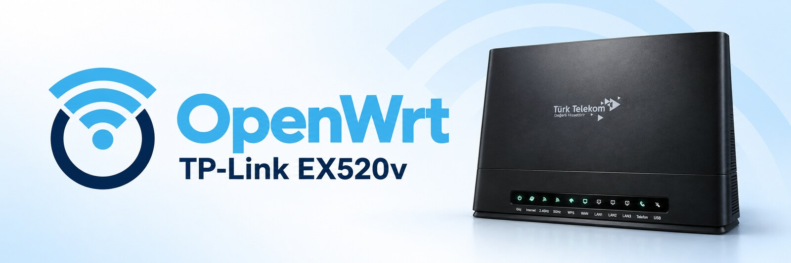
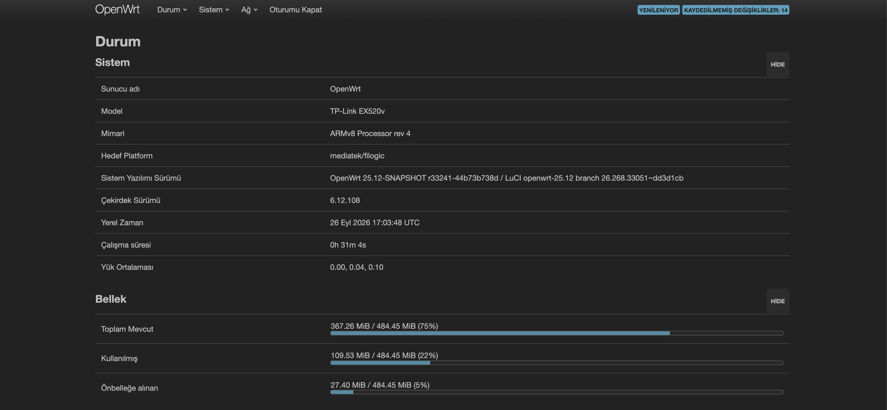

<p align="center">
  
</p>

# TP-Link EX520v için OpenWrt

Bu depo, TP-Link EX520v'ye (Türk Telekom AX3000) OpenWrt kurmak için
hazırlanmıştır. İmajı oluşturan OpenWrt kaynağı, cihaz desteği ve derleme
betikleri buradadır. Hazır imajları GitHub Actions derler. Dilerseniz imajı
kendiniz de derleyebilirsiniz.

Yönetim paneli (LuCI) ilk açılışta Türkçe gelir ve ek ayar gerektirmez. Dil,
Sistem → Sistem → Dil menüsünden değiştirilebilir.

<p align="center">
  
</p>

## Durum

Proje deneysel aşamadadır. Aşağıdaki özellikler çalışan bir cihazda
denenmiştir. İlk denemeler 26 Eylül 2026'da yapılmıştır.

- [x] RAM'den deneme açılışı
- [x] Flash'tan açılış, ayarlar yeniden başlatmada korunuyor
- [x] Türk Telekom fiber: VLAN 35 üzerinden PPPoE, public IP ve DNS
- [x] Fabrika kalibrasyonuyla 2,4 GHz ve 5 GHz Wi-Fi
- [x] Türkçe yönetim paneli (LuCI)
- [x] Stok firmware'e geri dönüş
- [x] LED'ler, butonlar, USB
- [x] Donanım hızlandırma (varsayılan olarak kapalıdır, bkz.
  [Donanım hızlandırma](#donanım-hızlandırma))

Telefon (FXS) portu çalışmaz.

## Gereksinimler

Kuruluma başlamadan önce aşağıdakiler hazır olmalıdır:

- TP-Link EX520v router. İmaj yalnızca bu modelde çalışır.
- Stok firmware'de root SSH erişimi. Kurulum betikleri router'a `root` olarak
  SSH ile bağlanıp flash'a yazar. Türk Telekom'un fabrika firmware'i bu erişimi
  vermez, erişimi sizin sağlamanız gerekir. Diğer yol, kasayı açıp seri konsol
  (UART) bağlamaktır. Bu depo o yolu kullanmaz.
- SSH istemcisi bulunan bir bilgisayar. Linux ve macOS'ta `ssh` hazır gelir.
  Windows'ta PuTTY ya da WSL2 kullanılabilir. Kurulum sırasında Wi-Fi
  kopabileceği için router'a kabloyla bağlanın.
- İki imaj dosyası: `...-initramfs-kernel.bin` (deneme) ve
  `...-squashfs-sysupgrade.bin` (flash). Dosyaları [Releases](../../releases)
  sayfasından indirebilir ya da kendiniz derleyebilirsiniz
  ([BUILD.md](BUILD.md)).

Root erişimi olmadan bu yöntem kullanılamaz. Erişiminiz yoksa kuruluma
başlamayın, aksi hâlde kurulum yarıda kalır.

## Kurulum

OpenWrt, stok firmware'in yedek slotuna (`ubi0`) kurulur. Stok firmware diğer
slotta (`ubi1`) olduğu gibi kalır. Seri konsol (UART) gerekmez.

Kurulum dört adımdan oluşur. Son adımdaki onaya kadar router kapatılıp
açılırsa stok firmware geri gelir. Böylece her aşamada geri dönüş mümkündür.

1. **Yedek alın.** Bilgisayarınızda `install/backup-stock.sh` betiğini
   çalıştırın. Betik tüm flash bölümlerini SSH ile indirir. Router'ın Wi-Fi
   kalibrasyonu ve MAC adresleri bu yedekte bulunduğu için yedeği saklayın.
2. **RAM'den deneyin.** Stok firmware'de `install/stock-install-trial.sh`
   betiğini çalıştırıp router'ı yeniden başlatın. OpenWrt RAM'den açılır.
   Router kapatılıp açılırsa stok firmware geri gelir.
3. **Flash'a yazın.** Deneme OpenWrt'sinde `install/openwrt-trial-to-flash.sh`
   betiğini çalıştırıp router'ı yeniden başlatın. OpenWrt bu aşamadan sonra
   flash'tan açılır. Router kapatılıp açılırsa yine stok firmware'e dönülür.
4. **Onaylayın.** Her şey çalışıyorsa `install/openwrt-confirm.sh` betiğini
   çalıştırın. OpenWrt kalıcı olur.

Stok firmware'e istediğiniz zaman dönebilirsiniz:

```sh
fw_setenv ex520v_trial; fw_setenv tp_boot_idx 1; reboot
```

> **Risk:** Kernel, sistem başlamadan çökerse router OpenWrt'yi açmaya devam
> eder. Bu durumda router yalnızca seri konsolla kurtarılabilir. 2. adımdaki
> deneme, bu hatayı flash'a kalıcı bir şey yazmadan yakalamak içindir. Kurulum
> bootloader'a (BL2, FIP, U-Boot) dokunmaz.

## İlk açılış

Wi-Fi ilk açılışta etkindir, kablo gerekmez.

| | |
|---|---|
| Wi-Fi adı | `OpenWrt-EX520v` (2,4 GHz ve 5 GHz) |
| Wi-Fi parolası | `openwrt-ex520v` (WPA2) |
| Yönetim paneli | http://192.168.1.1 |
| root parolası | boş |

> **Güvenlik:** Bu imajı kuran herkesin Wi-Fi adı ve parolası aynıdır.
> Kurulumdan hemen sonra şunları değiştirin:
>
> 1. Wi-Fi adı ve parolası: LuCI → Ağ → Kablosuz
> 2. root parolası: LuCI → Sistem → Yönetim

WAN, Türk Telekom fiber için yapılandırılmış gelir (PPPoE, VLAN 35). LuCI →
Ağ → Arayüzler → WAN ekranında kullanıcı adınızı ve parolanızı girmeniz
yeterlidir.

## Donanım hızlandırma

Donanım hızlandırma varsayılan olarak kapalıdır. Kapalıyken PPPoE trafiği
işlemciyi doldurur ve 1 Gbps hatta hız düşük kalır. Ölçümde hız 379 Mbps'te
kalmıştır. Aşağıdaki iki ayar gerçek cihazda işlemci kullanımını %90'dan
%5-20'ye indirmiş, Wi-Fi üzerinden 764 Mbps ölçülmüştür:

```sh
uci set firewall.@defaults[0].flow_offloading=1
uci set firewall.@defaults[0].flow_offloading_hw=1
uci commit firewall
echo "options mt7915e wed_enable=Y" >> /etc/modules.conf
reboot
```

## OpenWrt sürümü

İmajlar OpenWrt 25.12 (kernel 6.12) ile derlenir. 25.12, OpenWrt'nin en
güncel kararlı sürüm serisidir. Taban olarak `openwrt-25.12` dalının 25 Eylül
2026 tarihli `44b73b7` commit'i kullanılır. Bu commit, v25.12.5'ten sonra dala
eklenen düzeltmeleri de içerir.

OpenWrt kararlı dala yeni özellik eklemez, yalnızca hata ve güvenlik
düzeltmelerini alır. Kararlılık ve güvenlik açısından en doğru seçim bu daldır.

## Güven ve doğrulama

- Cihaza özel kod `patches/` (~360 satır) ve `files/` klasörlerindedir. Geri
  kalanı değiştirilmemiş OpenWrt'dir.
- `build.sh` OpenWrt commit'ini, `config/feeds.conf` paket commit'lerini
  sabitler. Her derleme aynı kaynaktan çıkar.
- Hazır imajları GitHub Actions bu depodan derler ve build log'unu herkes
  görebilir. GitHub her imaja bir attestation ekler. İmajın bu depodan
  derlendiği `gh attestation verify` ile doğrulanabilir.
- CI'ya güvenmek istemezseniz imajı kendiniz derleyebilirsiniz.

## Derleme

```sh
./build.sh
```

Gereksinimler, derleme adımları ve imaj doğrulama [BUILD.md](BUILD.md)
dosyasında anlatılır.

## Teknik notlar

### Stok bootloader

- U-Boot, `tp_boot_idx` env değişkenine göre slot seçer: `1` ise `ubi1`, başka
  bir değer ya da boşsa `ubi0`.
- Seçilen slotta `uboot`, `kernel` veya `rootfs` volume'u eksik ya da bozuksa
  U-Boot diğer slota geçer. Kernel açıldıktan sonra takılırsa geçmez. Açılış
  sayacı ve web kurtarma yoktur.
- İkinci U-Boot, imzasız FIT imajlarını açar.
- TP-Link'in güncelleme betiği (`/usr/bin/do_upgrade.sh`) pasif slota bu
  yöntemle yazar. Kurulum betikleri de aynı yöntemi kullanır.
- Deneme modunu bu depo ekler, stok firmware'de yoktur. `ex520v_trial=1` iken
  OpenWrt her açılışta `tp_boot_idx=1` yazar
  (`files/lib/preinit/05_ex520v_trial`). Böylece bir sonraki açılış stok
  firmware'e gider.

### Donanım

| | |
|---|---|
| SoC | MediaTek MT7981B, 2× Cortex-A53 |
| RAM | 512 MiB |
| Flash | 512 MiB Micron SPI-NAND, NMBM (son 128 blok) |
| Switch | MT7531, GMAC0 (2500base-x). lan1 = 3, lan2 = 2, lan3 = 1 |
| WAN | GMAC1, dahili GbE PHY |
| Wi-Fi kalibrasyonu | `misc_ro` UBIFS, `0x00440000` dosyası (ilk 4 KiB) |
| MAC tabanı | `misc_ro` UBIFS, `0x0038F1E0` dosyası. WAN +1; LAN +5; 2,4 GHz +6; 5 GHz +7 (stokla aynı) |

## Lisans

GPL-2.0-or-later, upstream OpenWrt ile aynıdır. Device tree:
GPL-2.0-or-later veya MIT.
